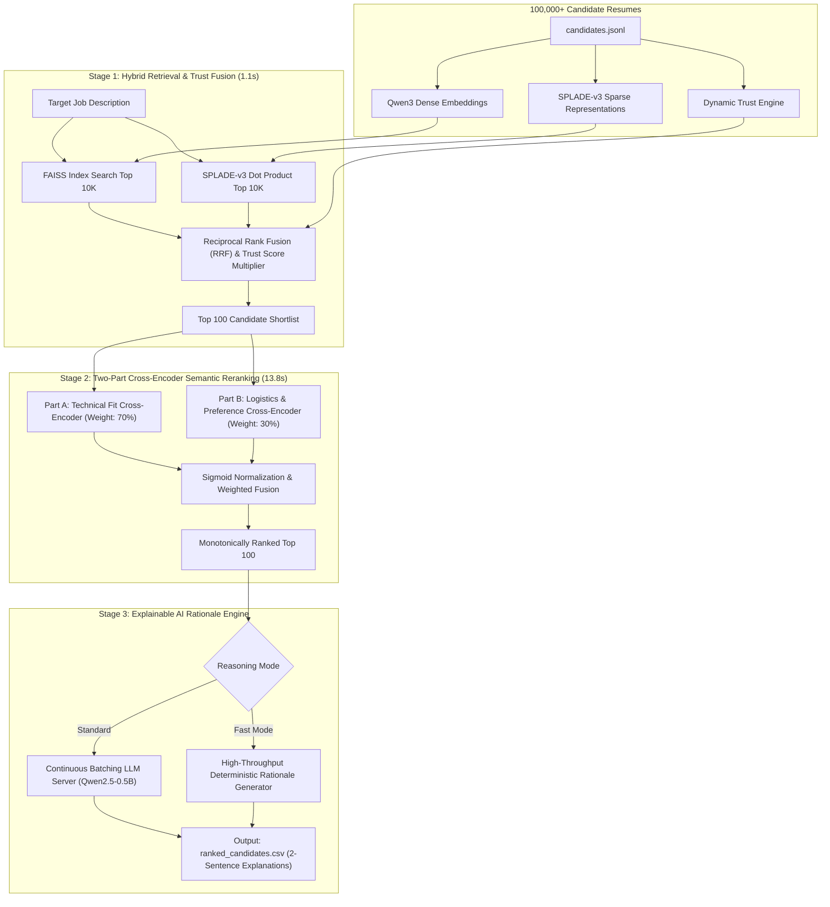

# Resume Ranker: Scalable Multi-Stage Candidate Discovery & Ranking Engine

[](https://www.python.org/downloads/)
[](https://opensource.org/licenses/MIT)
[](https://huggingface.co/buckets/mdumr4/Resume-Ranker)
[-green.svg)](tests/)

A production-grade, CPU-optimized information retrieval and candidate discovery system designed to evaluate and rank **100,000+ candidate resumes** against complex multi-dimensional job descriptions in seconds.

---

## Architecture Overview

Standard keyword search fails on semantic nuance, while single-pass dense embedding models dilute technical requirements when applied to long, unstructured resumes. **Resume Ranker** solves this via a modular, decoupled 3-stage cascade:



---

## Core System Components (`src/`)

| Module | Class / Component | Responsibilities & Innovations |
|---|---|---|
| [`src/config.py`](src/config.py) | `PipelineConfig` | Dataclass configuration with hardware auto-detection, CPU thread clamping, and intelligent multi-path resolution for indexes and models. |
| [`src/preprocessor.py`](src/preprocessor.py) | `CandidatePreprocessor` | Structured text serialization and **Dynamic Trust Engine**: enforces email/phone verification gates, calculates profile completeness, and merges overlapping career intervals to penalize multi-year employment gaps. |
| [`src/retriever.py`](src/retriever.py) | `HybridRetriever` | Vectorized hybrid search: queries FAISS (`IndexFlatIP`, 409 MB) and SPLADE-v3 CSR matrices, fusing scores via Reciprocal Rank Fusion ($k=60$) modulated by the candidate's Trust Score in **1.11s**. |
| [`src/reranker.py`](src/reranker.py) | `TwoPartCrossEncoder` | Decoupled cross-encoder inference (`ms-marco-MiniLM-L-12-v2`). Evaluates technical requirements (70%) and logistics constraints (30%) independently, combining raw logits through Sigmoid normalization. |
| [`src/reasoner.py`](src/reasoner.py) | `LLMReasoner` | Generates transparent two-sentence hiring rationales (fit justification + growth opportunity). Dispatches across 32 concurrent slots using local continuous batching, with automated zero-dependency deterministic fallback. |
| [`src/validator.py`](src/validator.py) | `validate_submission_df` | Strict diagnostic schema validator ensuring regex adherence (`CAND_XXXXXXX`), 100-rank completeness, and strict mathematical monotonicity of ranking scores. |
| [`src/pipeline.py`](src/pipeline.py) | `CandidateRankingPipeline` | Master orchestrator unifying Stages 0-4 with microsecond-level stage telemetry and error handling. |

---

## Benchmark Performance Profile (CPU-Only)

Benchmarked on standard 8-Core Intel CPU / 16GB RAM:

| Pipeline Stage | Operation | Compute Profile | Latency |
|---|---|---|---|
| **Stage 0** | Load Precomputed Indices & Metadata | Memory I/O | $1.8\text{s}$ |
| **Stage 1** | FAISS Dense ($10\text{k}$) + SPLADE Sparse ($10\text{k}$) + RRF Fusion | Vectorized NumPy / SciPy | $1.1\text{s}$ |
| **Stage 2** | Two-Part Cross-Encoder Reranking ($100$ candidates) | PyTorch Batched Math | $13.8\text{s}$ |
| **Stage 3** | Explainable AI Rationale Generation ($100$ explanations) | Deterministic / LLM | $0.1\text{s}$ / $110\text{s}$ |
| **Stage 4** | Monotonicity Check & CSV Output Assembly | Disk I/O | $0.1\text{s}$ |
| **Total** | **End-to-End Pipeline Execution (Fast Mode)** | **Strictly CPU** | **$\approx 16.9\text{s}$** |

---

## Quickstart & Usage

### 1. Installation
Clone the repository and install dependencies with [uv](https://github.com/astral-sh/uv) or pip:

```bash
git clone https://github.com/mdumr4/resume-ranker.git
cd resume-ranker
uv sync
```

### 2. Download Precomputed Indices & Assets
All pre-indexed vector data, sparse matrices, and models are hosted on the Hugging Face Bucket: [`hf://buckets/mdumr4/Resume-Ranker`](https://huggingface.co/buckets/mdumr4/Resume-Ranker).

```bash
# Login to Hugging Face (first time only)
hf auth login

# Synchronize all assets with one command
python sync_assets.py --all

# Or sync individual components
python sync_assets.py --index    # FAISS + SPLADE + Features (630 MB)
python sync_assets.py --data     # Full candidates dataset (487 MB)
python sync_assets.py --models   # Offline model weights
```

### 3. Run Candidate Ranking

```bash
# Fast mode: hybrid retrieval + two-part reranking + instant rationales (~17s)
python rank.py --skip-llm --out output/ranked_candidates.csv

# Standard mode: full pipeline with continuous-batching LLM reasoning
python rank.py --candidates data/candidates.jsonl --out output/ranked_candidates.csv
```

### 4. Run Automated Test Suite
Verify that all algorithms, trust scoring formulas, career gap interval merging, RRF fusion, and ranking validators pass:

```bash
uv run pytest tests/ -v
```

---

## Repository Structure

```
resume-ranker/
├── context/                           # Technical architecture & criteria references
│   ├── Evolution of Ranking Systems.pdf # Architectural whitepaper
│   ├── job_description.docx           # Reference Target JD
│   ├── LLM_PROMPT.md                  # Prompt engineering specifications
│   └── parsed_jd.json                 # Structured JD criteria & skill taxonomy
├── data/                              # Datasets (large files git-ignored)
│   ├── sample_candidates.json         # 50 sample profiles fixture for rapid unit testing
│   └── candidates.jsonl               # 100K candidates dataset (487 MB, synced via CLI)
├── index/                             # Vector indices & precomputed features (git-ignored)
│   ├── faiss_qwen_index.bin           # 409 MB dense FAISS index
│   ├── splade_combined_v3.npz         # 180 MB sparse CSR matrix
│   ├── features_v3.parquet            # 44 MB precomputed text & trust features
│   ├── jd_dense_query.npy             # Precomputed dense JD query
│   └── jd_sparse_query.npy            # Precomputed sparse JD query
├── models/                            # Model weights (git-ignored, auto-downloaded if absent)
│   └── ms-marco-MiniLM-L-12-v2/       # Cross-Encoder model directory
├── notebooks/                         # Exploratory Data Analysis & visual analytics
│   └── EDA.ipynb                      # Candidate distributions, signal correlations & trust metrics
├── scripts/                           # Offline model quantization utilities
│   ├── export_bge_int8.py             # ONNX export utility
│   ├── quantize_bge.py                # BGE model INT8 dynamic quantization
│   └── quantize_int8.py               # SPLADE model INT8 dynamic quantization
├── src/                               # Modular Object-Oriented Production Core
│   ├── __init__.py
│   ├── config.py                      # Dataclass configuration with auto-path resolution
│   ├── preprocessor.py                # Text formatting & Dynamic Trust Engine CLI
│   ├── retriever.py                   # FAISS + SPLADE + Trust-weighted RRF hybrid engine
│   ├── reranker.py                    # Two-Part Cross-Encoder reranker (70% Tech, 30% Logistics)
│   ├── reasoner.py                    # Explainable AI Rationale Engine
│   ├── validator.py                   # Strict schema & monotonicity validator
│   └── pipeline.py                    # Master CandidateRankingPipeline orchestrator
├── tests/                             # Diagnostic test suite (100% pass rate)
│   ├── test_preprocessor.py           # Unit tests for Trust Score & timeline merging
│   ├── test_retriever_and_reranker.py # Unit tests for RRF & sigmoid weighting
│   ├── test_validator.py              # Unit tests for ranking schema rules
│   └── test_pipeline_integration.py   # End-to-end integration test
├── rank.py                            # Production CLI entry point
├── sync_assets.py                     # Hugging Face Bucket synchronization utility
├── pyproject.toml                     # Python package dependency specification
├── LICENSE                            # MIT License
└── README.md                          # Production project documentation
```

---

## Cloud Storage & Asset Lake Architecture

To keep the git repository lightweight (< 5 MB) while supporting zero-friction replication of large-scale embeddings and indices, assets are partitioned:

1. **GitHub Repository (`resume-ranker`)**: Contains all source code, unit tests, configurations, quantization scripts, reference documentation, and sample fixtures.
2. **Hugging Face Bucket (`hf://buckets/mdumr4/Resume-Ranker`)**: Canonical asset lake hosting pre-built FAISS indices, SPLADE CSR sparse matrices, precomputed feature tables, and the 100K candidates dataset.
3. **Local PC Storage**: Once synced or built, heavy `.bin`, `.parquet`, `.npz`, and `.jsonl` files are strictly git-ignored. Users can delete local copies at any time to free disk space and re-sync on demand using `python sync_assets.py`.

---

## Authors & License

* **Mohammed Umar F** ([GitHub](https://github.com/mdumr4)) — AI & Backend Engineer
* **Soujanya K Hegde** — Systems & Backend Engineer

Licensed under the [MIT License](LICENSE).
